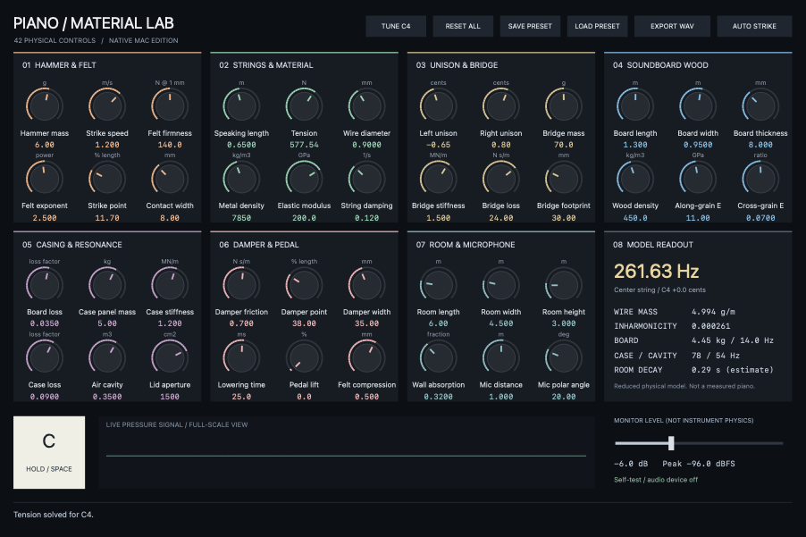

# Piano Material Lab — Mac

A native Mac piano workbench with **42 physical controls**, a playable white key,
live waveform, exact parameter entry, presets, and WAV export. All sound is
synthesized from scratch. No piano samples, MIDI, Python, or other runtime installs
are needed to play.



This is a separate Mac port of [PixelPotts/piano-material-lab](https://github.com/PixelPotts/piano-material-lab),
with its development history preserved. The original Windows app remains there.

## Download and open

Download **Piano-Material-Lab-macOS-universal.zip** from [Releases](../../releases/latest).
Unzip it, drag **Piano Material Lab.app** to Applications, and open it.
The same app supports **Apple Silicon and Intel, macOS 11 or later**.

This build is ad-hoc signed, not Apple Developer ID signed or notarized. macOS may
block the first launch. After attempting to open the app, use **System Settings →
Privacy & Security → Open Anyway**, then confirm Open. On older macOS versions,
the equivalent control is in System Preferences → Security & Privacy.
[Apple's instructions](https://support.apple.com/en-us/102445).

## Play and adjust

- Hold the white key, **Space**, or **C** to play; release to damp the strings.
- Drag knobs vertically. **Shift** gives fine adjustments; scrolling also works.
- Double-click a knob to enter an exact value. **Return** applies; **Escape** cancels.
- Right-click a knob to restore its default. **Reset All** restores the instrument.
- **Tune C4** solves tension for the current string material and dimensions.
- **Auto Strike** repeats while you adjust. **S** toggles the sustain pedal.
- **Save Preset / Load Preset** stores and restores one user preset.
- **Export WAV** opens a native save dialog for a six-second rendered note.
- **Tab** selects the next knob; arrows adjust it; Return opens exact entry.
- **Escape** stops automatic striking and releases the pedal and key.

The window scales to fit a laptop display and can be resized. Settings and presets
live in `~/Library/Application Support/Piano Material Lab/`. Physical settings save
on quit. The monitor volume starts at 50% each launch and does not affect WAV export.
Windows and Mac `.piano` presets use the same format.

## Model and limits

The shared C engine has three stiff strings with 32 modes each, nonlinear hammer
contact, a bridge model, 64 soundboard plate modes, case and cavity resonances,
damper contact, and room reflections. The controls change physical quantities such
as mass, force, tension, dimensions, stiffness, loss, and absorption.

This is a reduced physical model, not a measured piano or full 3D simulation.
See [the model](MODEL.txt), [the 42 controls](CONTROL-GUIDE.txt), and
[Mac validation](MAC-VALIDATION.txt). Historical Windows validation documents apply
to the original Windows version.

## Build on a Mac

Install Apple's Command Line Tools (`xcode-select --install`), then:

```sh
bash macos/build.sh
open 'build/Piano Material Lab.app'
```

The build uses Apple's Clang, Cocoa, and AudioToolbox. It produces a universal app
and ZIP in `build/`. `macos/Piano.m` supplies the native interface and Core Audio
queue; `synth.h` and `parameters.h` contain the shared C model and presets.
The Windows sources remain in the history and tree for reference.

## Tests

With Python 3 and NumPy available, after building:

```sh
./build/engine-validation
./build/synth-cli --test
./build/synth-cli --sweep
python3 verify-sound.py
python3 tools/verify-sweep.py
'build/Piano Material Lab.app/Contents/MacOS/PianoMaterialLab' --self-test
```

GitHub Actions builds both architectures and runs the engine and native Cocoa
interaction tests on Intel and Apple Silicon runners. The UI test uses temporary
settings, saves a screenshot and JSON results, and exits without starting an audio
device. Generated PCM tests exercise the actual engine. They do not verify physical
Mac speakers, perceived realism, or hardware-specific audio latency.
